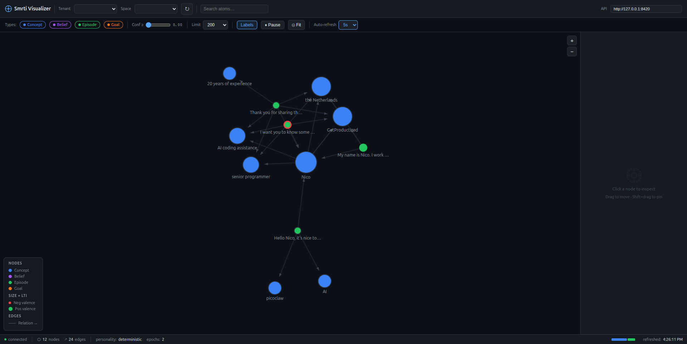
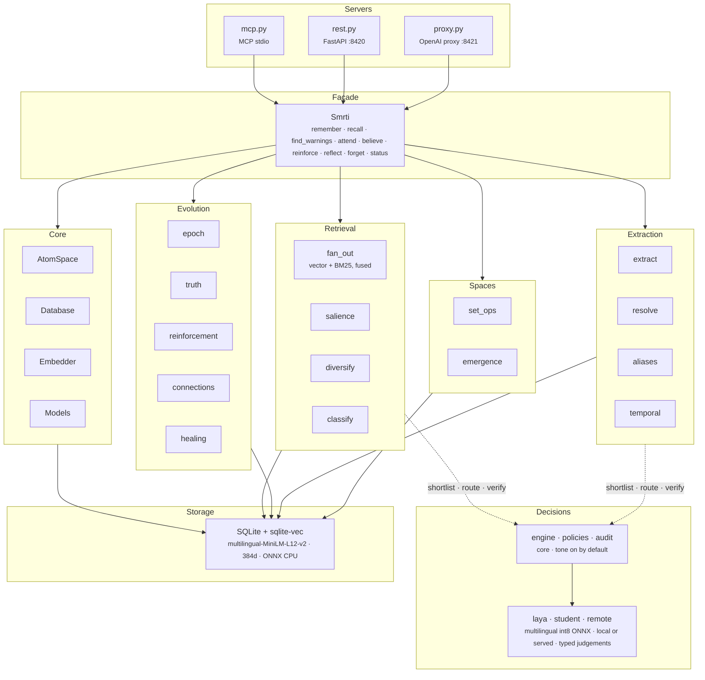

# smrti

[](https://pypi.org/project/smrti/)
[](https://pypi.org/project/smrti/)
[](LICENSE)
[](https://github.com/cyqlelabs/smrti/actions/workflows/ci.yml)
[](https://codecov.io/gh/cyqlelabs/smrti)

**Long-term memory for AI agents in a single SQLite file.** Your agent remembers what matters, forgets what doesn't, and sees the warnings you flag whenever they bear on a request. No vector database, no external services, no infrastructure.

Inspired by [AtomSpace](https://github.com/opencog/atomspace): memories are graph nodes with truth values, attention weights, and emotional valence. Retrieval fuses vector and lexical search, expands one hop through extracted relations, and ranks by relevance scaled by standing (attention, confidence, tone) under a personality that sets the weights, so a memory unrelated to the question never ranks, however important it is elsewhere. Consolidation runs when the agent is used, not when the clock ticks.

- [Why smrti](#why-smrti)
- [Install](#install)
- [Quick Start](#quick-start)
- [How It Works](#how-it-works)
- [Server Modes](#server-modes) (MCP, REST, proxy, visualizer)
- [Configuration Reference](#configuration-reference)
- [Security & Monitoring](#security--monitoring)
- [Multi-Tenant / Space Model](#multi-tenant--space-model)
- [Personality System](#personality-system)
- [Architecture](#architecture)
- [Data Model](#data-model)
- [smrti-town](#smrti-town)
- [Testing](#testing)
- [Benchmarks](#benchmarks)
- [Upgrading](#upgrading)

## Why smrti

- **Zero infrastructure** — one SQLite file with [sqlite-vec](https://github.com/asg017/sqlite-vec) for KNN, and ONNX embeddings, NER, and decisions on CPU (no PyTorch anywhere). `pip install` and go.
- **Error-avoidance memory** — a warning you state (a valence set through the API or MCP, or the proxy's `X-Smrti-Valence` header) survives pruning and reaches the agent whenever it bears on the request, even when recall's `top_k` cut it. Every result comes back classified as `critical_warning`, `known_antipattern`, or `context`.
- **Knowledge graph** — in the server modes, a GLiNER2 + LLM pipeline extracts entities and typed relations from what you store and resolves pronouns against the graph; no manual schema.
- **Three integration paths** — MCP server, REST API, or an OpenAI-compatible proxy that adds memory to an existing app by changing one base URL.
- **Multilingual** — 50+ languages through multilingual embeddings, zero-shot NER, and language-agnostic sentiment. Lexical search and word-overlap checks segment spaced scripts on word boundaries and Chinese and Japanese into character bigrams; other unspaced scripts (Thai, Lao, Khmer, Burmese) are not segmented and are found through embeddings only.
- **Personality-driven** — six presets (17 hyperparameters) shape what each agent notices, retains, and forgets.

## Install

```bash
pip install smrti
```

### Container

Same package as `pip install smrti`, with the embedding model bundled so a fresh container recalls offline instead of stalling on a first-run download.

```bash
docker run -d -p 8420:8420 -v smrti-data:/data ghcr.io/cyqlelabs/smrti
```

That serves the REST API. Any other command replaces it, and every environment variable in the [configuration reference](#configuration-reference) works as usual:

```bash
docker run -d -p 8421:8421 -v smrti-data:/data \
  -e SMRTI_UPSTREAM_URL=http://host.docker.internal:11434/v1 \
  -e SMRTI_API_KEY=your-key \
  ghcr.io/cyqlelabs/smrti serve proxy --host 0.0.0.0 --port 8421
```

- **Tags** — every `v*` release publishes `latest`, the exact version, and a rolling `MAJOR.MINOR`; pin whichever you want to track.
- **Storage** — `/data` holds the database, the weights that download on first use (NER on the first extraction, the decision model on the first decision), and the mapped copies of the embedding and NER models that the first load writes; mount a volume or all of them die with the container.
- **User** — runs as non-root `smrti`.

## Quick Start

### Python API

```python
from smrti import Smrti

mem = Smrti(db_path="~/.smrti/memory.db", personality="balanced")

# Store memories
mem.remember("Alice prefers TypeScript", probability=0.9, valence=0.3)
mem.remember("The deploy pipeline is broken", probability=0.95, valence=-0.7)

# Recall by relevance and salience
results = mem.recall("programming languages")
for r in results:
    print(f"{r.atom.label} (salience={r.salience:.2f}, confidence={r.atom.truth.confidence:.2f})")

# Report that the recalled memories were used
mem.reinforce([r.atom.id for r in results])

# Assert a belief with a reason, and read the reason back
atom_id = mem.believe("Python is the best language for ML", probability=0.85, evidence="Team survey results")
print(mem.evidence(atom_id)[0].text)

# Stop a memory from surfacing
mem.forget("deploy pipeline")

# Consolidate: revise evidence, decay, promote, prune
epoch = mem.reflect()
print(f"Updated {epoch.beliefs_updated} beliefs, pruned {epoch.atoms_pruned} atoms")
```

The constructor also takes `tenant_id`, `write_space`, `read_spaces`, `ignore_patterns`, and `temporal` (see [Multi-Tenant / Space Model](#multi-tenant--space-model)). The Python API stores, recalls, forgets, and consolidates; entity extraction and relative-date resolution run in the server modes (pass `temporal=True` for dates here).

Three model downloads happen on first use, each once: the embedding model (first `remember`/`recall`), the [decision model](#semantic-decisions) (250 MB, or the 93 MB student on small machines), and the NER weights (first extraction, server modes only; about 1.1 GB on disk). With the default decision settings the model loads on a background thread at the first `remember` whose estimated tone is −0.3 or lower; that write keeps its estimate. `SMRTI_DECISIONS=off` skips the download. Plan memory for what you turn on: the decision model peaked at 746 MB resident on the tone benchmark (about 1.07 GB with the embedding model), and the NER encoder holds about 400 MB plus its tokenizer. The total resident size of a server with everything on has not been measured; `SMRTI_DECISIONS=off` and `SMRTI_EXTRACT_MODE=llm` (no local tagger) are the two switches that shrink it most.

### CLI

```bash
smrti init --db ~/.smrti/memory.db --personality balanced   # create a database
smrti status                                                # inspect it

smrti serve mcp        # MCP stdio server (Claude, etc.)
smrti serve rest       # REST API on :8420
smrti serve viz        # REST API + memory visualizer in the browser
smrti serve proxy      # OpenAI-compatible proxy on :8421
smrti serve town       # city-builder simulation demo on :8430
smrti serve decisions  # student decision model on :8731 (see Semantic decisions)

smrti stop             # gracefully stop all servers started by `smrti serve`
smrti stop rest        # stop one mode (rest, viz, proxy, town, decisions); --port to narrow further
```

## How It Works

> [Full pipeline diagram →](docs/pipeline.md)

### `remember()`

Embeds and stores text as a typed atom (episode, concept, belief, or goal) with a truth value, attention weight, and valence.

- `valence` unset is estimated from the text. Set it yourself and the memory is a deliberate report, the only kind recall can raise to a behavioral constraint. `intensity` is how strongly the tone is felt; unset, it is `|valence|`.
- `type="belief"` is `believe()`: a belief starts at confidence 0.3 and earns more through evidence. Asserted at probability ≥ 0.95 it is permanent and exempt from decay. The `evidence` reason is filed on the evidence log at weight 0, since the assertion already counts it; `evidence(atom_id)` lists it.
- In the server modes, relative dates are resolved to the day against the write time ("the session is tomorrow" still names a day next week). A week ("next week", "in two weeks"), a month, a year, an ambiguous numeric date (12/03/1990), or a duration with no direction ("two weeks") is left as written.
- In the server modes, entities and relations are extracted into the graph. A mention merges with an existing entity only on an exact label, a compatible-type label, a stored alias, or a case- and accent-folded label; a near match makes a new entity rather than risk a wrong merge.
- A claim that replaces an earlier one with the same subject and predicate (a new city, a new employer, a changed preference) is recorded as superseding it. A claim with a different predicate never cuts another, and a claim read from the agent's reply never replaces one the user stated, nor revives one the user replaced.

### `recall()`

Runs a vector KNN and a BM25 search over the read spaces, fuses them by Reciprocal Rank Fusion, expands one hop through the graph, and ranks by salience:

```
S = similarity × ( w_sim + w_sti × sti + w_conf × confidence + w_lti × lti + w_val × |valence| × intensity )
```

Similarity multiplies the standing terms, so a memory unrelated to the question (cosine at or below zero) never ranks, and standing reorders the related ones. On top of that:

- When valence < −0.5, weight shifts from STI to valence, so an old error keeps its standing against recent trivia (it does not always rank first; a stated warning reaches the agent through its own search). Valence terms read the tone a memory was written with, not the mood it has absorbed.
- An episode that restates the query is dropped: its word overlap with the query must reach 80% of the larger of the two word sets (50% when either side has under three words) and its own text, re-embedded, must reach a cosine of 0.9 with the query. An answer that shares the question's words, like "My sister's name is Laura." for "What is my sister's name?", is kept.
- `agent_source_trust` discounts an agent-authored memory's standing, never its similarity.
- Episodes repeating one already chosen from the same minutes share `max(2, top_k // 6)` slots. Up to two slots go to beliefs whose similarity is at least a third of the best candidate's.
- Results below the personality's `min_confidence_to_surface` are excluded unless you pass `min_confidence`. A stated warning, and a failure the user reported at valence under −0.7 and intensity over 0.7, pass the floor however far their confidence decayed. Forgotten memories never return.
- With the `rerank` [decision task](#semantic-decisions) on (it is off by default), the decision model judges the top candidates as evidence for the question and blends that judgement with salience; each result then carries an `evidence` score. `rerank=False` skips the judgement for one call. Only what is returned gets the access boost; `attend(atom_ids)` boosts what an external reranker kept out of a wider `recall(boost=False)`, and returns how many memories it raised. The REST and MCP `recall` take both flags.

Each result carries a `severity`: `critical_warning` (a valence you stated, under −0.5 at intensity over 0.5, on anything but a bare concept, and not replaced by a later claim), `known_antipattern` (a belief or extracted claim that a later claim replaced, or whose probability fell below 0.3 at confidence above 0.3; episodes, goals and concepts never qualify), or `context`. An *estimated* valence never makes a critical warning, however negative: it scores the mood of the words, not a report of a mistake. To record one, state the valence: `remember(..., valence=-0.9)`, the MCP/REST `valence` field, or the proxy's `X-Smrti-Valence` header.

Two lookups reach past the ranked list. `find_warnings(query)` returns up to three stated warnings whose cosine with the query is at least 0.3, wherever they rank, without boosting them. `superseded_claims(atom_ids)` returns, for each atom, the claims a later claim replaced. The MCP and REST recall responses carry both, as `warnings` and `superseded`, and the proxy injects them.

### `forget()`

Stops memories from surfacing. They are excluded from every recall, no consolidation lifts them back, and the next epoch may prune them. Forgetting is final, so a query forgets only clear matches: up to `top_k` (5) results in the write space whose similarity to the query is at least `min_similarity` (0.35) and within 85% of the best match's — never simply the nearest ones. Quoting a memory back finds it. To forget an exact set, recall first and pass the ids: `mem.forget(atom_ids=[...])` (also `atom_ids` on the MCP tool and `POST /forget`). A forgotten memory's pending evidence is retired and its attention set to zero.

By default the concepts and claims extracted from a forgotten episode stay. `mem.forget(..., cascade=True)` (also `cascade` on the MCP tool and `POST /forget`) also deletes each claim edge whose recorded source episodes are all forgotten, and forgets each concept that no remaining episode mentions and no surviving claim names, in one transaction. A claim extracted by an earlier release recorded no episodes and is kept. Cascade touches the write space only.

### `reinforce()`

Reports that recalled memories were used; a cheap test is that distinctive words from a memory appeared in the reply it informed. Use is weak evidence: confidence climbs a little, capped per epoch and discounted for agent-authored memories, and probability does not move.

### `reflect()`

One consolidation epoch: revise pending evidence, decay attention and confidence, propagate both to neighbors, heal orphaned episodes, promote high-STI atoms to long-term importance, resolve contradictions (a superseded claim loses), link similar high-LTI atoms (every tenth epoch), and prune what fell below the floors. The servers run one every `SMRTI_REFLECT_INTERVAL` seconds for each space used in that interval, so idle memory does not age. One process consolidates a space at a time: the epoch holds a lease row in the database (five minutes, renewed inside every write, so a stalled holder's late write is rolled back), and a run that cannot take it returns an empty result and keeps the space's activity for the next interval. What you told the agent (episodes, beliefs and goals) decays only to the surfacing floor and stays recallable unless you forget it, and the two ends of a current claim you stated are never pruned. What the agent inferred keeps fading, faster for agent-authored atoms. Contradictions are *resolved* here, not detected: the epoch acts on `contradicts` edges, which extraction draws when a new claim supersedes an older one (or which you can draw yourself); it does not compare arbitrary sentences for conflict.

### Semantic decisions

At five points a rule cannot tell what a sentence means. Instead of a generative LLM call, the engine asks [Laya](https://github.com/NandhaKishorM/laya), a local multilingual model that answers typed questions (a probability, a choice among options, a score) and never writes prose. It runs as an int8 ONNX graph with no PyTorch, and peaked at 746 MB resident on the tone benchmark. Each task's default follows its measurement (table below): only `tone` is on. You can set any task to `active`, `shadow` (ask and record, apply nothing) or `off`. A failure or timeout falls back to the deterministic path, and with the defaults recall never waits on the model, because `tone` runs on the write path only.

The runtime installs with Smrti; the weights do not. The first decision fetches them once (250MB, checked against a checksum) into `~/.smrti/decision-model`, or reuses `~/.factor/decision-model` when [Factor](https://github.com/cyqlelabs/factor) already holds a copy. Fetch and load run on their own thread, and a call that arrives before the model is ready takes the deterministic path. `SMRTI_DECISIONS_MODEL` points at a directory you unpacked yourself. `SMRTI_DECISIONS_URL` asks a server that already holds the model (Factor's EdgeJev on loopback, `smrti serve decisions`, or any `POST /v1/systemone`) and loads nothing here, since a small machine can hold one copy of the model, not two. `SMRTI_DECISIONS=off` downloads nothing at all.

Laya needs AVX2. Without it, a 2011 dual-core took 30 to 48 seconds per decision against a 5-second deadline. So on a CPU without AVX2, or a machine with less than 4 GB of memory, a smaller student model answers instead: a 6-layer multilingual encoder trained on Laya's answers, fetched once (93 MB) into `~/.smrti/student-model`. It answers in 0.1 to 2.3 seconds on that same dual-core and agrees with Laya on 75–94% of Smrti's questions. It cannot judge `entity`, because the candidates change with every call, so entity matches there take the deterministic path. `SMRTI_DECISIONS_ENGINE` forces either model. `smrti serve decisions` serves the student on `:8731` so Factor and several Smrti processes can share one copy through `SMRTI_DECISIONS_URL`.

| Task           | Decides | Default | Measurement behind the default |
| -------------- | ------- | ------- | ------------------------------ |
| `routing`      | Whether an episode needs the LLM claim extraction. Chatter skips it; a durable fact that names no entity can force it. | `off` | On the gate set (`make bench-decisions`) it avoided 1 of 11 skippable LLM calls and skipped claim extraction for 2 of 11 durable facts. "Never deploy on Fridays." was not forced to the LLM. |
| `rerank`       | Whether each shortlisted memory answers the question, links to the answer, describes a replaced state, or contradicts the premise; blended with salience. | `off` | LongMemEval-S at `top_k=5`: hit rate 0.650 with it, 0.675 without. It added about 4.5 s to each uncached recall. |
| `supersession` | Whether a new claim replaces an older one. Ambiguity keeps both. | `off` | On 25 English and Spanish pairs (`make bench-supersession`) it blocked 12 of 13 wrong cuts of a current fact but let one through, and blocked 7 of 8 real updates. |
| `entity`       | Which existing atom an uncertain mention names. Under the confidence line, a duplicate is made rather than a wrong merge. | `off` | On 17 cases (`make bench-entity`) no answer reached the 0.6 line: no wrong merges, and none of the 9 true ones. |
| `tone`         | Whose an *estimated* negative valence is: about the thing the memory describes, or the speaker's own mood. Mood is damped so an apology does not rank and persist like the failure it is about; a stated valence is never questioned. | `active` | On 29 sentences (`make bench-tone`) it damped 2 of 14 speaker-toned ones, both apologies, and none of the 15 about a failure, bug, rule or preference. |

Turn a task on with `SMRTI_DECISIONS_<TASK>=active` (for example `SMRTI_DECISIONS_RERANK=active`); `SMRTI_DECISIONS=active` turns on all five, and `SMRTI_DECISIONS=off` turns off `tone` too. A `DecisionPolicy()` built in code starts with every task active.

A decision never restores a forgotten atom, confers permanence, changes tenant or space, or mints a critical warning. Its confidence is logged, never written into a truth value.

```bash
export SMRTI_DECISIONS=off                      # deterministic only
export SMRTI_DECISIONS_RERANK=active            # per task: off | shadow | active
export SMRTI_DECISIONS_MODEL=/models/laya-int8  # a directory you unpacked; no download
export SMRTI_DECISIONS_ENGINE=student           # auto | laya | student
export SMRTI_DECISIONS_THREADS=2                # cap the cores inference may hold
```

`GET /decisions` lists every decision, and `/metrics` counts them as `smrti_decisions_total`. `make bench-decisions` scores the routing gate, `make bench-tone` the tone check, `make bench-supersession` and `make bench-entity` the two verification tasks, and `make distill` retrains the student. Thresholds are in the [Configuration Reference](#configuration-reference).

## Server Modes

### MCP Server

Exposes 8 tools over stdio for direct LLM integration.

**Claude Code:**

```bash
claude mcp add smrti -- smrti serve mcp
```

**Claude Desktop** (or any MCP client) — add to your MCP config:

```json
{
  "mcpServers": {
    "smrti": {
      "command": "smrti",
      "args": ["serve", "mcp"],
      "env": { "SMRTI_DB": "~/.smrti/memory.db" }
    }
  }
}
```

| Tool                  | Description                                                                                       |
| --------------------- | ------------------------------------------------------------------------------------------------- |
| `smrti_remember`      | Store an episode, goal, or belief (use `type=belief` + `evidence` to assert a probabilistic fact) |
| `smrti_recall`        | Vector and BM25 search fused, ranked by salience, each result classified by severity; returns `memories`, plus `warnings` (stated warnings recall did not return) and `superseded` (claims a later claim replaced). `boost=false` and `rerank=false` read without the access boost or the evidence judgement |
| `smrti_reflect`       | Run a consolidation epoch                                                                         |
| `smrti_forget`        | Stop memories matching a query, or exact `atom_ids`, from surfacing; the next epoch may prune them |
| `smrti_status`        | Memory statistics and the tenant's spaces                                                         |
| `smrti_personality`   | Get or set the personality preset                                                                 |
| `smrti_space_query`   | Compare two spaces: `op=overlap` (Jaccard), `op=intersection`, `op=diff`                          |
| `smrti_space_merge`   | Materialize a bridge space from the overlap between two spaces                                    |

### REST API

Full CRUD over HTTP on port 8420:

```bash
smrti serve rest --host 0.0.0.0 --port 8420
```

```bash
# Store a memory
curl -X POST http://localhost:8420/remember \
  -H "Content-Type: application/json" \
  -d '{"content": "Alice prefers TypeScript", "probability": 0.9}'

# Recall
curl -X POST http://localhost:8420/recall \
  -H 'Content-Type: application/json' \
  -d '{"query": "programming languages", "top_k": 5}'

# Report that recalled memories shaped the reply — being used builds confidence
curl -X POST localhost:8420/reinforce \
  -H 'Content-Type: application/json' \
  -d '{"atom_ids": ["4f2c…", "9ab1…"]}'

# Run consolidation
curl -X POST http://localhost:8420/reflect

# Get status
curl http://localhost:8420/status

# Compare two spaces (op = overlap | intersection | diff)
curl -X POST http://localhost:8420/space_query \
  -H 'Content-Type: application/json' \
  -d '{"op": "overlap", "other_space": "personal"}'

# Grow a bridge space from what two spaces share
curl -X POST http://localhost:8420/space_merge \
  -H 'Content-Type: application/json' \
  -d '{"other_space": "personal", "min_jaccard": 0.1}'

# Boost only what you kept from a wide, unboosted recall you reranked yourself
curl -X POST http://localhost:8420/attend \
  -H 'Content-Type: application/json' \
  -d '{"atom_ids": ["4f2c…"]}'

# The semantic decision log (see "Semantic decisions"), newest first
curl http://localhost:8420/decisions
```

Every endpoint takes an optional `space` to route the call; `/space_query` and
`/space_merge` compare that space with `other_space` and refuse a self-compare.
`/recall` answers with `memories`, `warnings` (stated warnings that bear on the
query but were not returned) and `superseded`, one
`{about, subject, predicate, old_object, new_object}` entry per replaced claim
about a returned memory. `PUT /personality` answers 422 for a value outside its
valid range. A request body over `SMRTI_MAX_BODY_BYTES` (8 MiB) is a 413.

### OpenAI-Compatible Proxy

The fastest way to add memory to an existing app: point your OpenAI client at the proxy and keep everything else the same. It intercepts each chat request, injects relevant memories into the system prompt, and stores the exchange afterward.

```bash
smrti serve proxy --host 0.0.0.0 --port 8421 --upstream https://api.openai.com
```

```python
from openai import OpenAI

client = OpenAI(
    base_url="http://localhost:8421/v1",
    api_key="sk-..."  # forwarded to upstream
)

response = client.chat.completions.create(
    model="gpt-4o",
    messages=[{"role": "user", "content": "What do you know about Alice?"}],
    extra_headers={
        "X-Smrti-Tenant-Id": "user_123",
        "X-Smrti-Write-Space": "work",
        "X-Smrti-Read-Spaces": "work,personal",
    }
)
```

On every request the proxy:

1. Recalls relevant memories from the read spaces, building the query from recent conversation context (not just the last message)
2. Injects them into the system prompt as labelled lines, each with a confidence qualifier: `Constraint:` for a stated warning, `Outdated:` for a replaced or disproven claim (a superseded fact reads `Outdated: Alice lives_in Berlin → Paris`), and `Note:` for background context. The `YOU MUST NOT` and `AVOID` rules are stated once, above the lines they govern. Stated warnings that bear on the request are added even when `top_k` cut them.
3. Stores the user message and assistant response as episodes once the upstream has returned a complete 2xx answer (identical episodes are deduplicated per tenant/space). The proxy reads tone from the text, and an estimated tone never becomes a `critical_warning`. A client that knows the user is reporting a mistake to avoid sends `X-Smrti-Valence: -0.9` (and optionally `X-Smrti-Intensity`) with that request, and the user message is stored with the valence stated. An out-of-range or non-numeric value is a 400.
4. Extracts entities and claims into concept nodes and typed relation edges

Works with any OpenAI-compatible upstream, including local llama.cpp, vLLM, or Ollama endpoints; an upstream URL that already ends in `/v1` is not doubled. `GET /v1/models` is passed through, and an upstream error status (with its `Retry-After`) reaches the client, streams included. The proxy never forwards its own key: a client that authenticates to smrti with `X-Api-Key` keeps its `Authorization` header for the upstream.

### Memory Visualizer

`smrti serve viz` opens a browser-based graph explorer to inspect atoms, relations, and attention weights, plus an **LLM Calls** debug tab showing every extraction request with full request/response, timing, and recalled memories. With an API key set, the page opens on a login form (see [Security & Monitoring](#security--monitoring)).

[](docs/visualizer.png)

## Configuration Reference

All server modes read the same environment variables. Everything works with zero configuration; set these to customize.

**Core (all modes):**

| Variable                 | Default              | Purpose                                            |
| ------------------------ | -------------------- | -------------------------------------------------- |
| `SMRTI_DB`               | `~/.smrti/memory.db` | Database file path                                 |
| `SMRTI_HOME`             | `~/.smrti`           | Where the decision models are unpacked             |
| `SMRTI_PERSONALITY`      | `balanced`           | Personality preset                                 |
| `SMRTI_TENANT_ID`        | `default`            | Tenant partition (hard isolation)                  |
| `SMRTI_SPACE`            | `default`            | Write space                                        |
| `SMRTI_READ_SPACES`      | write space          | Comma-separated spaces to read from                |
| `SMRTI_REFLECT_INTERVAL` | `60`                 | Seconds between consolidation epochs (0 = off); only spaces used during the interval get one |
| `SMRTI_RUN_DIR`          | `~/.smrti/run`       | Where `smrti serve` writes PID files so `smrti stop` can find its servers |
| `SMRTI_IGNORE_PATTERNS`  | —                    | Newline-separated regexes; matching content is dropped before storage (see below) |

**Security (REST / proxy / viz):**

| Variable               | Default   | Purpose                                                                                  |
| ---------------------- | --------- | ---------------------------------------------------------------------------------------- |
| `SMRTI_API_KEY`        | —         | Admin key, valid for every tenant. Setting it or `SMRTI_API_KEYS` makes every request send `Authorization: Bearer <key>` or `X-Api-Key: <key>` |
| `SMRTI_API_KEYS`       | —         | Tenant-bound keys: `key:tenant1\|tenant2` entries separated by `;` or `,`. A malformed or repeated entry stops the server |
| `SMRTI_MAX_BODY_BYTES` | `8388608` | Largest request body REST and the proxy accept (8 MiB); a larger one is a 413 (0 = no limit) |
| `SMRTI_CORS_ORIGINS`   | —         | Comma-separated allowed origins for the proxy; CORS middleware is only added when set    |
| `SMRTI_VIZ_DBS`        | —         | `:`-separated extra SQLite paths the visualizer may open (default: the server's own DB only); refused for tenant-bound keys |

**Proxy:**

| Variable                      | Default                  | Purpose                                                  |
| ----------------------------- | ------------------------ | -------------------------------------------------------- |
| `SMRTI_UPSTREAM_URL`          | `https://api.openai.com` | Upstream OpenAI-compatible API                           |
| `SMRTI_RECALL_TOP_K`          | `10`                     | Memories to inject per request; stated warnings are added outside this count |
| `SMRTI_RECALL_MIN_CONFIDENCE` | personality floor        | Confidence floor for injected memories                   |
| `SMRTI_QUERY_MODE`            | `concat`                 | Recall query source: `concat` recent context or `last` message only |
| `SMRTI_QUERY_CONTEXT_MSGS`    | `5`                      | Recent messages included in the recall query             |
| `SMRTI_QUERY_MAX_CHARS`       | `500`                    | Max characters of the recall query                       |
| `SMRTI_INJECT_MAX_CHARS`      | `500`                    | Max characters per injected memory                       |
| `SMRTI_INJECT_BUDGET_CHARS`   | `0`                      | Total characters of injected memory per request, constraints first, then context in rank order (0 = no budget) |

**Extraction (all modes):**

To get the knowledge graph from `serve rest` or `serve mcp`, point `SMRTI_EXTRACT_URL` (and `SMRTI_EXTRACT_MODEL`) at an OpenAI-compatible endpoint; the proxy uses its upstream. Unset, extraction runs local NER only.

| Variable                 | Default                    | Purpose                                                          |
| ------------------------ | -------------------------- | ---------------------------------------------------------------- |
| `SMRTI_EXTRACT`          | `1`                        | Entity/claim extraction after every `remember` (0 = off)         |
| `SMRTI_EXTRACT_MODE`     | `hybrid`                   | `hybrid` (GLiNER + LLM), `llm` (LLM-only), `local` (no LLM)      |
| `SMRTI_EXTRACT_URL`      | proxy upstream, else unset | LLM endpoint for extraction calls; unset with no upstream = `local` mode |
| `SMRTI_EXTRACT_MODEL`    | request model              | Model for extraction calls                                       |
| `SMRTI_EXTRACT_API_KEY`  | —                          | Bearer token for extraction calls. Unset, the request's own `Authorization` is forwarded, never a smrti key; MCP sends none |
| `SMRTI_EXTRACT_THINKING` | `disabled`                 | `disabled` / `auto` / `enabled`; `disabled` is faster and avoids token-budget exhaustion on thinking models |
| `SMRTI_EXTRACT_TIMEOUT`  | `60`                       | Extraction request timeout in seconds                            |
| `SMRTI_NER_MODEL`        | `lmo3/gliner2-multi-v1-onnx` | GLiNER2 ONNX model for local zero-shot NER                     |
| `SMRTI_TEMPORAL`         | `1`                        | Resolve relative dates against the write time (0 = store text verbatim); one NER pass per write, never in `llm` mode, where the extraction model resolves dates itself |

**Semantic decisions (all modes, see [above](#semantic-decisions)):**

| Variable                                      | Default                   | Purpose                                                                       |
| --------------------------------------------- | ------------------------- | ----------------------------------------------------------------------------- |
| `SMRTI_DECISIONS`                             | per task: `tone` active, the rest `off` | Mode for every decision task: `off`, `shadow` (ask and record, apply nothing), `active` |
| `SMRTI_DECISIONS_ROUTING` / `_RERANK` / `_SUPERSESSION` / `_ENTITY` / `_TONE` | `SMRTI_DECISIONS`, else the task's default | Per-task mode override                       |
| `SMRTI_DECISIONS_ENGINE`                      | `auto`                    | Local model: `laya`, `student`, or `auto` (the student on a CPU without AVX2 or under 4 GB of memory) |
| `SMRTI_DECISIONS_MODEL`                       | Laya: Factor's copy, else `~/.smrti/decision-model`; student: `~/.smrti/student-model` | Model directory to load; unset, the weights are fetched there on first use |
| `SMRTI_DECISIONS_URL`                         | unset                     | A server already holding the model (EdgeJev's `POST /v1/systemone`, e.g. Factor's on `http://127.0.0.1:8731`); set, nothing is loaded here |
| `SMRTI_DECISIONS_DEVICE`                      | auto                      | Execution provider passed to Laya's ONNX runtime; unset lets it choose         |
| `SMRTI_DECISIONS_THREADS`                     | `min(4, CPU count)`       | Cores one decision may hold; cap it on a machine that has two of them          |
| `SMRTI_DECISIONS_TIMEOUT`                     | `5`                       | Deadline per decision in seconds, and the budget for a whole rerank; on expiry the deterministic path answers |
| `SMRTI_DECISIONS_COOLDOWN`                    | `60`                      | Seconds the engine stops asking after a failure (0 = never). A provider failure pauses every task; a malformed answer pauses only its task; a model still loading, or a rerank that spent its budget, pauses nothing |
| `SMRTI_DECISIONS_CACHE`                       | `256`                     | Answers kept in the LRU cache; a state names the atoms it was built from, so it invalidates itself (0 = no cache) |
| `SMRTI_DECISIONS_RERANK_SHORTLIST`            | `20`                      | Most candidates judged per recall, one call each; judging stops when the next would overrun the deadline |
| `SMRTI_DECISIONS_RERANK_WEIGHT`               | `0.5`                     | Share of the final order the evidence judgement decides against salience      |
| `SMRTI_DECISIONS_RERANK_MIN_EVIDENCE`         | `0`                       | Drop judged candidates under this evidence score (0 = rerank only, never filter); a stated warning is never dropped |
| `SMRTI_DECISIONS_ROUTING_SKIP` / `_FORCE`     | `0.2` / `0.75`            | Lines under which every routing judgement means "skip the LLM", and over which a durable fact or correction forces it |
| `SMRTI_DECISIONS_SUPERSESSION_MIN_CONFIDENCE` | `0.6`                     | Choice confidence a supersession verdict needs before the older claim is marked replaced |
| `SMRTI_DECISIONS_ENTITY_MIN_CONFIDENCE`       | `0.6`                     | Choice confidence an entity verdict needs before an uncertain match is accepted |
| `SMRTI_DECISIONS_ENTITY_CANDIDATES`           | `5`                       | Matches each resolution tier offers for verification                          |
| `SMRTI_DECISIONS_TONE_MIN_CONFIDENCE`         | `0.4`                     | Choice confidence a tone verdict needs before an estimated valence is damped; under it the estimate stands. Measured: `make bench-tone` |
| `SMRTI_DECISIONS_TONE_DAMPING`                | `0.25`                    | What an estimated valence is multiplied by when the tone is judged the speaker's mood rather than the memory's; under every line the engine draws through a tone. Must lie in [0, 1] |

### Ignoring Automated Messages

Agentic frameworks often produce periodic system messages (heartbeat checks, status pings, tool scaffolding) that should not pollute memory. Any `remember()` call matching `SMRTI_IGNORE_PATTERNS` is silently dropped before embedding or extraction:

```bash
export SMRTI_IGNORE_PATTERNS="^# Heartbeat Check
^HEARTBEAT_OK$"
```

Patterns are matched with `re.search` (anchors optional) and apply to all server modes.

## Security & Monitoring

**API key auth** — HTTP servers are open by default for local use. Setting a key requires one on every REST, proxy, and visualizer request, sent as `X-Api-Key: <key>` or `Authorization: Bearer <key>` (the scheme is case-insensitive); an unknown key is a 401. Two kinds exist:

| Key | Set with | May act on |
| --- | -------- | ---------- |
| Admin | `SMRTI_API_KEY` | Every tenant |
| Tenant-bound | `SMRTI_API_KEYS="k1:acme\|beta;k2:gamma"` | Only the tenants listed. A request naming another tenant (`X-Smrti-Tenant-Id` or `?tenant_id=`) is a 403, and so are `?db=` and clearing the shared `/llm-calls` and `/decisions` logs. With no tenant named, the key acts on its first one. `/tenants`, `/llm-calls`, `/decisions` and `/metrics` show only its tenants |

A browser cannot send the header, so with a key set `/viz` shows a login form. The key is posted once in the request body, and the browser keeps only a random session token in an HttpOnly, SameSite=Strict cookie, which authenticates reads only and ends when the server restarts. The CLI warns when you bind to a non-loopback host without a key set, and `serve town` and `serve decisions`, which check no key at all, warn on any non-loopback bind.

**Prometheus metrics** — REST and proxy expose `GET /metrics` in Prometheus text format, with zero extra dependencies. Gauges include `smrti_atoms_total`, `smrti_atoms_by_type`, `smrti_epoch_count`, and the active personality hyperparameters, all labeled by `tenant` and `space`.

## Multi-Tenant / Space Model

**Tenants** are hard walls inside the engine: every read, write, epoch, set operation and entity resolution is partitioned by tenant, and a delete never touches another tenant's rows. Over HTTP the wall holds against a client only with tenant-bound keys (`SMRTI_API_KEYS`, see [Security](#security--monitoring)). Without a key any client may name any tenant, and `SMRTI_API_KEY` is an admin key for all of them. **Spaces** are permeable layers within a tenant: you write to one, read from many, and each has its own personality and consolidation cycle.

```python
researcher = Smrti(tenant_id="team", write_space="researcher",
                   read_spaces=["researcher", "shared"], personality="curious")
deployer   = Smrti(tenant_id="team", write_space="deployer",
                   read_spaces=["deployer", "shared"], personality="deterministic")
coordinator = Smrti(tenant_id="team", write_space="coordinator",
                    read_spaces=["coordinator", "shared", "researcher", "deployer"],
                    personality="analytical")
shared = Smrti(tenant_id="team", write_space="shared")
```

Each space consolidates independently: the researcher forgets fast, the deployer holds onto critical failures, and the coordinator reads everything through its own personality. This suits agent teams with private working memory and shared context, multi-agent simulations, and per-role views of one user.

Spaces also support set operations (overlap, intersection, difference, union, symmetric difference) and can materialize a **bridge space** from what two spaces share, via the `space_query` and `space_merge` MCP tools or the `POST /space_query` and `POST /space_merge` REST endpoints. Bridges are built only on request, never by the consolidation epoch. Set operations skip forgotten atoms, a forgotten bridge atom stays forgotten when its bridge is rebuilt, and a bridge copy never inherits a stated valence, so it cannot become a critical warning on its own.

## Personality System

Six built-in presets control retrieval behavior, decay rates, and emotional dynamics:

| Preset          | Bias                                       | Use Case                                 |
| --------------- | ------------------------------------------ | ---------------------------------------- |
| `balanced`      | Similarity 0.35, STI 0.25, confidence 0.20, LTI 0.10, valence 0.10 | General-purpose agents |
| `analytical`    | High confidence weight, low valence        | Logical reasoning, data-driven decisions |
| `curious`       | High STI weight, fast decay                | Exploration, novelty-seeking             |
| `empathetic`    | High valence weight, emotional propagation | Relationship-focused agents              |
| `maverick`      | Slow confidence decay (0.005), fast attention decay (STI 0.15, LTI 0.02), broad propagation | Independent, contrarian reasoning |
| `deterministic` | Fast learning, slow decay, laser focus     | Agentic workflows, code gen, deployments |

Each preset tunes 17 hyperparameters. To create a custom personality, start from a preset and override individual values via the `personality` DB table or `PUT /personality`. Every value is checked against its valid range: a profile built with one outside it raises, the REST route answers 422, the MCP tool returns an error, and a stored out-of-range value reads as that field's default.

<details>
<summary><strong>Hyperparameter reference</strong> (17 parameters, defaults from the <code>balanced</code> preset)</summary>

**Salience weights** — control how retrieval ranks results (should sum to ~1.0):

| Parameter | Default | Effect |
|-----------|---------|--------|
| `w_similarity` | 0.35 | Weight of embedding cosine similarity |
| `w_sti` | 0.25 | Weight of short-term importance (recency/access) |
| `w_confidence` | 0.20 | Weight of truth value confidence |
| `w_lti` | 0.10 | Weight of long-term importance |
| `w_valence` | 0.10 | Weight of emotional intensity (dynamically boosted when valence < -0.5) |

**Belief dynamics** — govern how confidence evolves over time:

| Parameter | Default | Effect |
|-----------|---------|--------|
| `confidence_decay_rate` | 0.02 | Per-epoch confidence decay. Higher = memories fade faster |
| `confidence_update_lr` | 0.3 | How far one observation moves a belief. Higher = new evidence counts for more |
| `min_confidence_to_surface` | 0.1 | Recall floor when the caller passes none; user testimony stops decaying here |

**Attention dynamics** — control what stays in focus:

| Parameter | Default | Effect |
|-----------|---------|--------|
| `sti_decay_rate` | 0.1 | Per-epoch STI decay. Higher = faster attention loss |
| `sti_boost_on_access` | 0.5 | STI added each time an atom is recalled. Higher = stronger recency bias |
| `sti_propagation_factor` | 0.15 | Fraction of STI boost propagated to linked atoms. Higher = broader activation |
| `lti_promotion_threshold` | 0.7 | STI above which an atom earns long-term importance. Higher = harder to earn |
| `lti_decay_rate` | 0.01 | Per-epoch LTI decay. Higher = long-term importance erodes faster |

**Provenance** — weighs what the agent wrote against what the user said:

| Parameter | Default | Effect |
|-----------|---------|--------|
| `agent_source_trust` | 0.5 | Standing of agent-authored memories relative to user-stated ones. Lower = model output fades faster while what the user said persists |

**Emotional dynamics** — shape how valence influences behavior:

| Parameter | Default | Effect |
|-----------|---------|--------|
| `valence_weight` | 0.2 | Strength of the weight shift from STI to valence for severely negative memories |
| `valence_propagation` | 0.1 | How far each epoch pulls a linked atom's mood toward the source's valence; the effective step is `valence_propagation × (1 − mood_inertia)`, 0.02 here. Moves the mood a recall result reports, not the tone ranking and severity judge on |
| `mood_inertia` | 0.8 | Resistance to mood shifts (0 = reactive, 1 = stable) |

</details>

## Architecture



**Retrieval:** embed the query → vector + BM25 search, fused → 1-hop graph expansion → salience ranking → evidence judgement (the `rerank` task, off by default) → diversity cap → top-k → access boost on what was returned. Stated warnings are looked up apart from that list. **Consolidation:** the epoch steps under [`reflect()`](#reflect).

## Data Model

| Atom Type  | Purpose                  | Example                          |
| ---------- | ------------------------ | -------------------------------- |
| `concept`  | Reusable entities        | "Alice", "Python", "OpenAI"      |
| `belief`   | Probabilistic facts      | "Alice prefers TypeScript"       |
| `episode`  | Timestamped observations | "User asked about deployment"    |
| `goal`     | Desired states           | "Finish the migration by Friday" |
| `relation` | Edges between atoms      | Alice → works_at → Acme Corp     |

Each atom carries:

- **TruthValue** — `probability` [0,1] and `confidence` [0,1]. Confidence grows with evidence: every stated reason, re-mention, report of use, or supersession revises it (PLN revision). For episodes and concepts, which hold no proposition, it is retention strength rather than truth.
- **AttentionValue** — `sti` (short-term importance, decays fast) and `lti` (long-term, accumulates).
- **Valence** — emotional tone [-1,1] and intensity [0,1]. Ranking and severity read the tone a memory was written with; the `valence` a recall result reports is its current mood, which drifts toward its neighbors during consolidation.
- **Evidence** — an append-only log of observations: the probability observed, its weight, who reported it, and what was observed (`text`).

## smrti-town

A living demo: [smrti-town](src/smrti_town/README.md) is a city-builder where every citizen carries a persistent smrti memory graph. You place the Town Hall and choose a mayor; an LLM-generated council debates what to build, citizens immigrate, work, and petition — and every decision they make is driven by what they remember.

```bash
smrti serve town   # simulation + frontend on :8430
```

## Testing

```bash
pytest tests/ -v
```

## Benchmarks

Two harnesses in `bench/` ingest a published dataset as episodes and answer its questions through `recall`. Retrieval and answering are scored separately, so a strong answering model cannot hide a retrieval regression.

**Retrieval** (2026-11-25): [LongMemEval-S](https://github.com/xiaowu0162/LongMemEval), 40 questions taken one per ability in turn · extraction off · no consolidation epochs · `deterministic` preset · decisions off unless the row says otherwise.

| `top_k` | Decisions | Hit rate | Evidence recall | Session hit rate |
| ------- | --------- | -------- | --------------- | ---------------- |
| 5 (proxy default) | off | **0.675** | 0.533 | 0.950 |
| 5 | every task active (Laya) | 0.650 | 0.481 | 0.925 |
| 10 (MCP and Python default) | off | **0.775** | 0.653 | 0.975 |
| 50 | off | **0.975** | 0.952 | 1.000 |

At `top_k=50` five of six abilities retrieve without a miss (multi-session misses 1 of 7). At `top_k=5` the weakest are questions about the assistant's own words (2 of 6) and temporal reasoning (4 of 7); with every decision task active, temporal reasoning falls to 2 of 7.

**Answers** (2026-08-26, older ranking formula): `top_k=50` · gemini-3.7-flash answering and judging · otherwise the same config. Re-run before reading these against the current engine.

| Benchmark | Scope | Answers | Notes |
| --------- | ----- | ------- | ----- |
| LongMemEval-S | 40 questions | **0.900** | |
| [HaluMem](https://huggingface.co/datasets/IAAR-Shanghai/HaluMem) | 3 personas, 180 questions | **0.517** correct | hallucination 0.394 · omission 0.089 |

```bash
make datasets        # fetch both into data/ (265MB + 32MB, once)
make bench           # fails if the retrieval hit rate drops
make bench-halumem   # fails if the hallucination rate rises

# add --extract-url/--extract-model to either to build the entity graph
# add --epochs N to consolidate each history N times before querying it
# add --top-k 10 to measure at the proxy's and the MCP tool's default injection budget
```

Each benchmark locks its config beside a recorded baseline and refuses to compare across configs; `--epochs` and `--top-k` join the fingerprint when set. The harness runs with every decision task off unless `--decisions shadow|active` is passed, which joins the fingerprint too: the gate measures the deterministic retrieval path the baselines were recorded on, and a decision-mode run needs its own baseline (`--update-baseline` under that mode). `--decisions active` refuses to run when the decision model cannot load. HaluMem's fingerprint also records the extraction model and mode when set, and the answering and judging models. Neither benchmark is a CI gate: both need the datasets, the embedding model, and a judge key.

**Where it is strong** (August answer run). Temporal reasoning and assistant's-own-words questions were answered perfectly at `top_k=50`. On HaluMem's *memory boundary* questions (things the user never said), smrti answered correctly 97% of the time and invented something 2.9% of the time.

**Where it is weak.** At `top_k=10`, the proxy's default, 9 of 40 questions retrieve none of their annotated evidence (13 at `top_k=5`). HaluMem's synthesis categories hallucinated heavily: dynamic update 71%, multi-hop inference 63%, generalization 62%. smrti rarely declined to answer (8.9% omission, where published systems omit 17–35%), so an unknown often came out as an assertion.

**Unmeasured.** The entity graph (`--extract-url`, about 1.25 s and one LLM call per turn) and consolidation (`--epochs`). HaluMem's memory-extraction and memory-update tasks are not implemented.

These numbers are not directly comparable to published results: the subsets are small (40 to 180 questions, so one question moves a category by several points), a single judge grades them where published protocols average three, and the answering model differs.

> **Leaderboard figures measure something else.** Published LongMemEval results (MemOS 77.8, Memobase 72.4, Mem0 66.4, Zep 63.8) are answer accuracy on all 500 questions. The retrieval table above is the share of 40 questions whose annotated evidence reached the returned memories, so the two cannot be ranked against each other.

## Upgrading

An existing database is upgraded the first time a newer version opens it. Migrations and data repairs are idempotent. The first open by this release does three things:

| Change | Runs | Snapshot |
| ------ | ---- | -------- |
| Creates the `epoch_lease` table and the indexes `idx_atoms_edge_out`, `idx_atoms_edge_in`, `idx_atoms_forgotten` and `idx_atoms_warning`, and drops `idx_atoms_sti` | Every open (no-op once done) | None |
| Deletes the `associated` edges at confidence ≤ 0.2 out of person atoms: the hubs the old healing step drew, plus association discovery's own edges, which discovery redraws on its next tenth epoch | Once per database, recorded as `repair_hub_edges` in `smrti_meta` | Only if no `.pre-migration.bak` exists yet |
| Rebuilds the tone of entities extracted by earlier versions, and sinks memories forgotten before this version so the pruner can remove them | Every open, on rows still in the old shape | Only if no `.pre-migration.bak` exists yet |

A schema migration (a column added to an existing table, or the vector index rebuilt) writes `<db>.pre-migration.bak` before it runs, replacing an older one; a data repair never replaces an existing snapshot, so the file a downgrade needs survives. Restore that file to downgrade. Bridge spaces an older epoch created on its own (`a_x_b`) are left in place; remove one with `DELETE /spaces/current?space=a_x_b`.

## License

MIT
